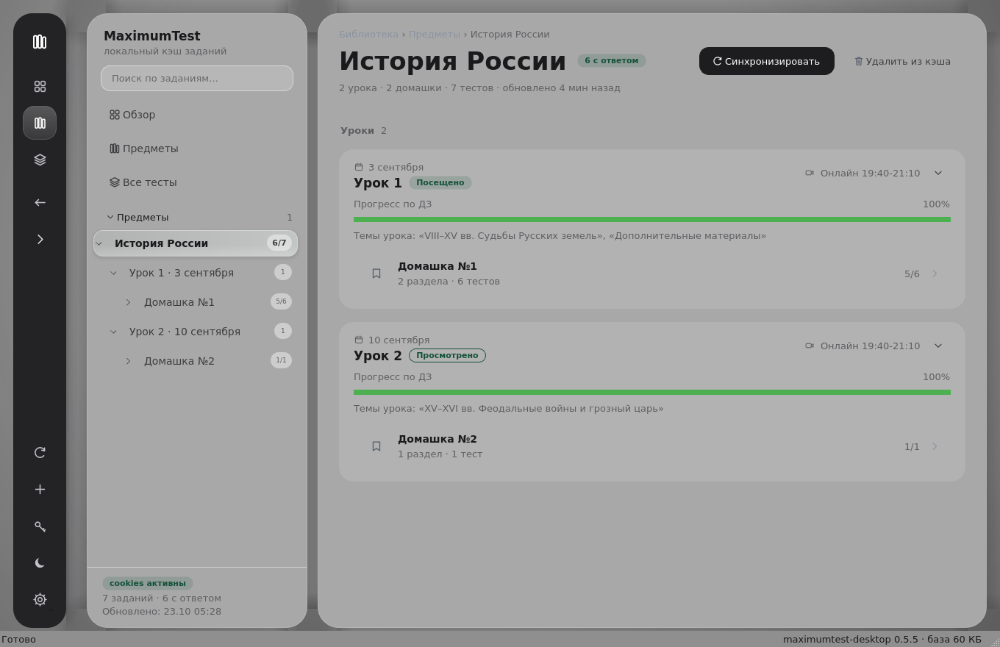
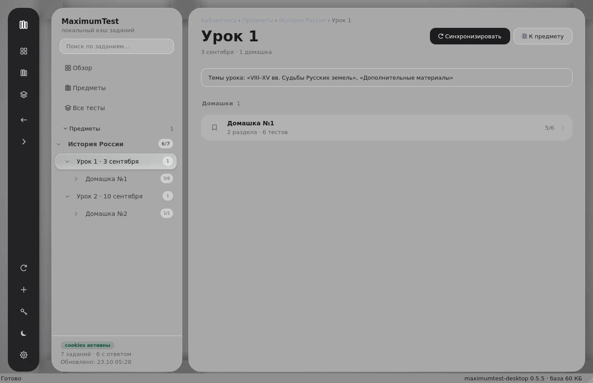
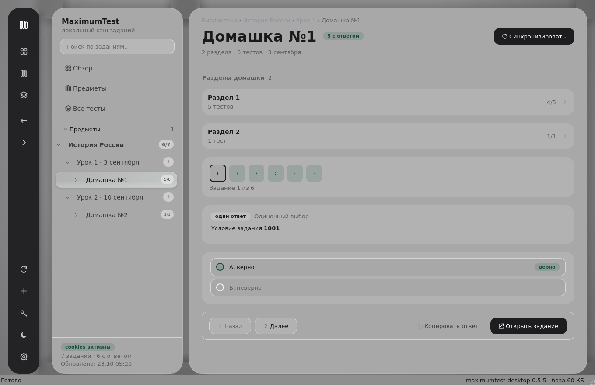
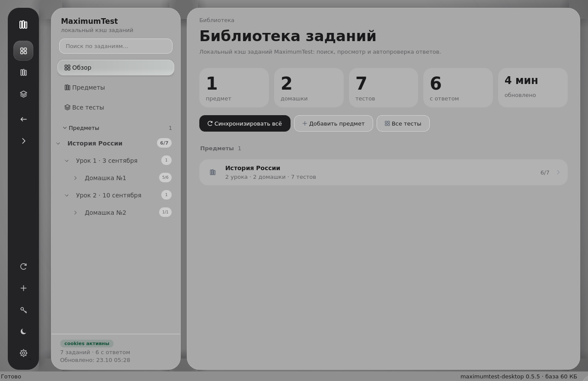
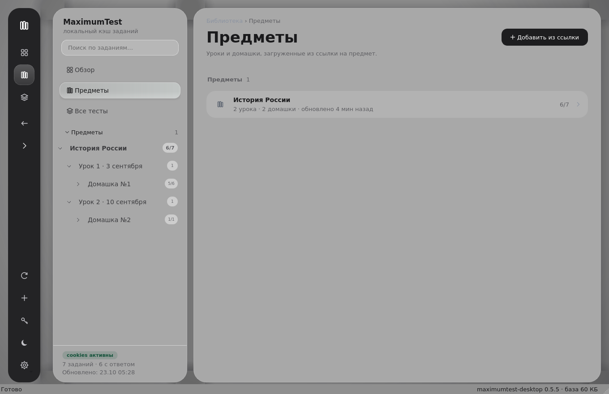
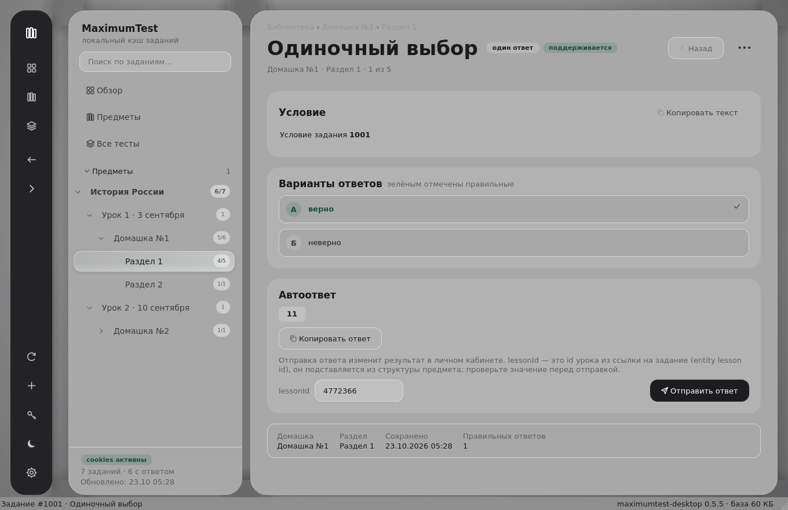
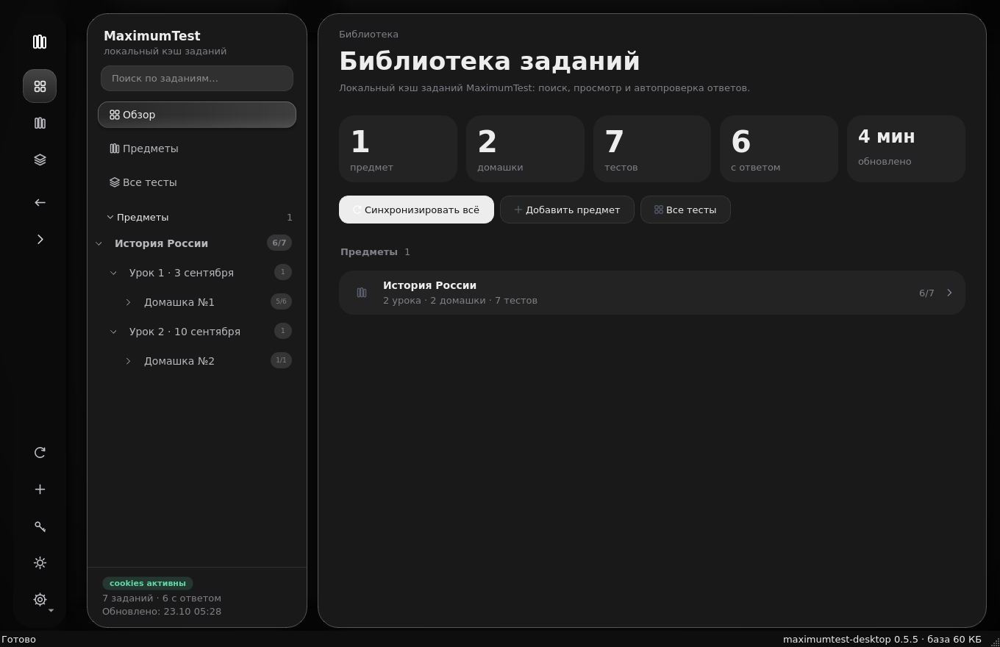

# MaximumTest Library

Десктопный просмотрщик заданий [education.maximumtest.ru](https://education.maximumtest.ru)
с локальным кэшем в SQLite. Работает офлайн, ничего не отправляет на сторонние
серверы и не требует пароля — доступ к заданиям выполняется через cookies вашей
сессии в браузере.



<p align="center">
  
  
</p>

<p align="center">
  
  
</p>

<p align="center">
  
  
</p>

## Что умеет

- **Предмет целиком из одной ссылки.** Вставьте адрес страницы предмета
  (`/student/courses/111137/lessons`) — приложение прочитает уроки
  (`education-groups`), структуру каждого урока (`structures`), найдёт блоки
  `curriculum_practice_block` и скачает все домашки со всеми заданиями.
  Внутренние «практики» остаются деталью хранения и в интерфейсе не показываются.
- **Страница предмета как на сайте.** Карточки уроков: дата, статус
  («Посещено» / «Просмотрено»), прогресс по ДЗ с полосой, темы урока и список
  домашек внутри — у каждого урока своя домашка. Темы/даты берутся из ответа API
  и показываются, если сервер их присылает. Домашка открывается своей страницей:
  разделы сверху, ниже тренажёр по всем её заданиям.
- **Домашка как тренажёр.** Сверху — пронумерованные кнопки всех тестов
  (текущий обведён, решённые подсвечены), ниже условие, варианты с отметками
  верных ответов и кнопки «Назад / Далее / Открыть задание».
- **Дерево «предмет → урок → домашка → раздел»** в боковой панели со счётчиками
  «с ответом / всего». У каждой строки с вложенными элементами свой шеврон:
  предмет, урок и домашка сворачиваются **по отдельности** и запоминают
  состояние (`Ctrl+B` прячет весь список). Название можно задать руками, если
  сервер его не прислал: ПКМ по предмету — в дереве, на его строке в «Предметы»
  или прямо по заголовку его страницы; так же переименовывается домашка.
  Такое имя хранится с флагом `manual_title` и переживает синхронизацию.
  Домашка всегда висит
  на своём уроке — связь берётся из структуры урока, а не из `lessonId` в дереве
  домашки (реальный сервер его не присылает).
- **Тёмная рельса навигации** слева: обзор, предметы, все тесты, назад/вперёд,
  синхронизация, добавление по ссылке, cookies, тема и настройки — кнопок в
  рабочей области остаётся минимум (лишние действия уходят в меню «…»).
  Рельса плавает над полотном и отбрасывает небольшую тень; под ней, в боковой
  панели, те же три раздела продублированы строками со стеклянной подсветкой.
- **Нормальные названия вместо ID.** Названия предметов, уроков и домашек
  ищутся по всему ответу API (включая `entityInfo` и `courseTitleForModule`),
  числовые заглушки отбрасываются: вместо `111137` показывается «История России».
  Уже сохранённый кэш чинится сам при первом запуске: имя достаётся из
  сохранённых ответов API, поэтому повторная синхронизация не нужна.
- **Ссылка на задание** (`/lesson/4772366/subjects/51610/practice/kbs/8931/tests/289165?type=online`)
  разбирается целиком: курс, урок, предмет, раздел, режим и номер задания.
  Если задание уже в кэше — оно сразу откроется, иначе скачается его предмет.
- **Синхронизация** предметов и разделов в локальную базу SQLite (WAL, пакетные
  транзакции), с отменой, повтором и подробным журналом. Запросы идут в
  человеческом темпе: перед каждым случайная пауза ≈1 с (0.6–1.4 с), чтобы не
  выглядеть ботом и не получить бан по частоте.
- **Скачано — значит навсегда.** Все задания, домашки и структура уроков лежат
  в `data.sqlite3` и никуда не пропадают: обновление экрана, перезапуск и
  повторная синхронизация ничего не удаляют, а «догрузок по клику» нет —
  страницы читаются из базы. Пустые и ошибочные ответы сервера кэш не затирают,
  а раздел удаляется только если сервер его больше не отдаёт **и** вся
  синхронизация прошла без ошибок. Стереть данные можно лишь вручную —
  «Удалить из кэша» или «Очистить кэш».
- **Мгновенный поиск** по всей базе: название задания, домашки, раздела, урока
  или предмета, любой ID — задания, домашки, раздела, урока (`id` и
  `entity_lesson_id`) и предмета. Числа сравниваются точно, а не как подстрока.
  Поиск из боковой панели сбрасывает фильтр «Все домашки», поэтому не может
  «залипнуть» внутри одной домашки. Регистронезависимый для кириллицы.
- **Просмотр задания**: условие с форматированием, все варианты с отмеченными
  правильными, готовый ответ и метаданные (lessonId, время сохранения).
  `lessonId` для отправки берётся из структуры курса — это тот самый
  *entity lesson id* из ссылки (`/lesson/4772366/…`), а не номер урока из дерева
  предмета.
- **Автоответ** для типов `type1`–`type5` по спецификации API: `type1`/`type2` —
  ID вариантов, `type3`/`type4` — тексты в порядке `sort`, `type5` — по одному
  полю на правильный ответ (из `variants` выбирается один допустимый вариант).
- **Отправка ответа** с явным подтверждением (действие изменяет результат в
  личном кабинете): `lessonId` строкой, `spentTime` 45–90 с, до 3 попыток с
  паузой 400 мс при временных сбоях, разбор ответа `{"result", "percent"}`.
- **Экспорт** предмета в JSON и просмотр исходного payload любого задания.
- **Светлая и тёмная тема**, автоматически подхватывает системную. В светлой
  нет белых панелей: полотно `#8F8F8F` с мягким затемнением по краям, панели
  `#A8A8A8` светлее полотна и лежат на нём с тенью. Выделение строки (в дереве, в
  навигации, на рельсе) — «liquid glass» как на референсе: почти прозрачное
  слева, молочное справа, с яркой волосяной кромкой и мягкой тенью.
- Горячие клавиши, история навигации, сохранение геометрии окна.

## Установка

Нужен Python 3.11+ и Linux с графической сессией (X11 или Wayland).

```bash
git clone https://github.com/InaymeI/HWlibrary.git
cd HWlibrary
./run.sh
```

`run.sh` создаст `.venv`, установит зависимости и запустит приложение.
Вручную то же самое:

```bash
python -m venv .venv
./.venv/bin/pip install -e .
./.venv/bin/python -m mt
```

## Первый запуск

1. Войдите на **education.maximumtest.ru** в браузере.
2. В приложении нажмите **Cookies сессии** → «Импорт из Firefox» (или
   скопируйте заголовок `Cookie` из DevTools → Network и вставьте в поле).
3. **Добавить предмет по ссылке** — вставьте ссылку. Поддерживаются:

   | Ссылка | Что произойдёт |
   | --- | --- |
   | `/student/courses/111137/lessons` | скачается предмет: уроки → практики (домашки) → разделы → задания |
   | `/lesson/4772366/subjects/51610/practice/kbs/8931/tests/289165?type=online` | откроется это задание (или скачается его предмет) |
   | `/subjects/51610/` или `51610` | скачается домашка |
4. После синхронизации задания доступны офлайн.

### Где хранятся данные

| Что            | Путь                                                    |
| -------------- | ------------------------------------------------------- |
| База SQLite    | `~/.local/share/maximumtest-desktop/data.sqlite3`       |
| Cookies        | `~/.local/share/maximumtest-desktop/cookies.json` (0600) |
| Настройки      | `~/.config/maximumtest-desktop/`                        |
| Журнал/кэш     | `~/.cache/maximumtest-desktop/`                         |

Каталоги можно переопределить переменными `XDG_DATA_HOME`, `XDG_CONFIG_HOME`,
`XDG_CACHE_HOME` или точечно — `MT_DATA_DIR`, `MT_CONFIG_DIR`, `MT_CACHE_DIR`.

## Быстрые клавиши

| Клавиши    | Действие                          |
| ---------- | --------------------------------- |
| `F5`       | синхронизировать текущий предмет   |
| `Ctrl+B`   | скрыть/показать список предметов    |
| `Ctrl+R`   | обновить интерфейс из кэша        |
| `Ctrl+N`   | добавить курс/предмет по ссылке    |
| `Ctrl+F`   | поиск по всем тестам              |
| `Ctrl+L`   | журнал синхронизации              |
| `Alt+←/→`  | назад / вперёд                    |
| `F1`       | справка                           |
| `Ctrl+Q`   | выход                             |

## Командная строка

```bash
./run.sh                                  # графический интерфейс
./.venv/bin/python -m mt --help
./.venv/bin/python -m mt --theme dark      # светлая/тёмная/системная тема
./.venv/bin/python -m mt --db /tmp/test.sqlite3   # отдельная база
./.venv/bin/python -m mt --sync 51610      # синхронизировать домашку
./.venv/bin/python -m mt --course 111137   # синхронизировать предмет целиком
./.venv/bin/python -m mt --link "https://education.maximumtest.ru/student/courses/111137/lessons"
```

`--sync`, `--course` и `--link` работают без графической сессии: окно не
открывается, прогресс печатается в stdout — удобно для cron.

## Соответствие API

| Что | Реализация |
| --- | --- |
| Уроки предмета | `GET /api/v3/student/education-groups/{courseId}?perPage=50&lastKnownId=<id>`; пагинация курсором по `id` последнего урока (`page` сервер игнорирует), дубли по `id` отбрасываются |
| Структура урока | `GET /api/v3/student/education-groups/{courseId}/structures/{lessonId}`; блоки практики (`curriculum_practice_block`, вложенные контейнеры, `subjectId`) ищутся на любой глубине, их `entityInfo.id` — это `subjectId` |
| Привязка домашки к уроку | из структуры урока: блоки практики, их `entityInfo.id` — это `subjectId`; связь хранится в `lesson_subjects` (поле `lessonId` в дереве предмета реальный сервер не присылает) |
| `entity lesson id` | `entityInfo.id` урока; именно он идёт в `lessonId` тела ответа |
| Дерево предмета | `GET /curriculumsubject/{sid}`; обход `online → offline → aftertheory`, `lessonId` сохраняется |
| Тесты раздела | `GET /…/knowledgebase/{kbs}/{mode}/tests`, режимы перебираются по порядку `kbs.mode → online → offline → aftertheory`, берётся первый массив |
| Пустые ответы | не кэшируются: ошибка или `[]` не затирает уже сохранённые данные |
| Дубли тестов | один объект на `test.id` (Set по id + `PRIMARY KEY` в SQLite) |
| Отправка ответа | `POST /…/tests/{tid}`: `lessonId` (строка), `attaches: []`, `answer`, `spentTime` 45–90 |
| `lessonId` fallback | структура курса (entity id) → ссылка `/lesson/<id>/subjects/…` → `tree.lessonId` → ручной ввод |
| Ответ сервера | `result: "true" \| false` и/или `percent: 100` |
| Ретраи | POST: 3 попытки, пауза 400 мс (только 5xx/429/сеть); GET: 2 повтора |
| Пауза между запросами | случайная 0.6–1.4 с (в среднем ≈1 с) перед каждым запросом; `MT_SYNC_DELAY="0.2,0.4"` меняет диапазон, `MT_SYNC_DELAY=0` отключает |

## Разработка

```bash
./.venv/bin/pip install -e ".[dev]"
./.venv/bin/python -m pytest            # 69 тестов, включая фиктивный сервер
./.venv/bin/python -m ruff check mt tests
```

Тесты не ходят в интернет: `tests/fake_server.py` поднимает локальный HTTP-сервер,
повторяющий нужные эндпоинты, и проверяет весь путь «синхронизация → база →
поиск → автоответ → отправка».

### Архитектура

```
mt/
├── __main__.py      точка входа, CLI (--sync/--course/--link), Wayland-детект, excepthook
├── links.py         разбор ссылок: предмет, урок, домашка, раздел, задание
├── config.py        пути, эндпоинты, константы (без побочных эффектов при импорте)
├── db.py            SQLite-кэш: схема, миграции, запросы, агрегаты
├── api.py           HTTP-клиент: ретраи, таймауты, безопасное хранение cookies
├── models.py        разбор payload'ов API в датаклассы + кэш разбора
├── answers.py       сборка ответа для типов type1–type5
├── sync.py          фоновый поток синхронизации (QThread)
├── theme.py         светлая/тёмная палитры и общий QSS
├── icons.py         иконки, рисуемые QPainter (без внешних ассетов)
├── widgets.py       переиспользуемые элементы интерфейса
└── ui/
    ├── main_window.py  окно, рельса навигации, боковая панель, синхронизация
    ├── pages.py        обзор, предмет, раздел, задание, все тесты
    └── dialogs.py      cookies, JSON, подтверждение отправки, результат, справка
```

Принципы:

- **UI никогда не парсит JSON.** Разбор живёт в `models.py` и кэшируется.
- **Соединение SQLite — на поток.** Запись только из воркера, чтение из UI.
- **Безопасная работа с QThread.** Завершённый воркер удаляется через
  `deleteLater`, поэтому ссылка проверяется через `sip.isdeleted`; необработанные
  исключения в слотах перехватываются `sys.excepthook` (иначе Qt делает `abort`).
- **Пакетная запись.** Один раздел — одна транзакция; упавшая синхронизация не
  ломает уже сохранённые данные.
- **Никаких внешних ассетов.** Иконки рисуются кодом, тема — один QSS-шаблон.

## Статус проекта

Приложение неофициальное. Эндпоинты могут измениться на стороне сервиса;
в этом случае синхронизация сообщит об ошибке, но кэш останется нетронутым.
Отправка ответов — на ваш риск.

## Лицензия

MIT
