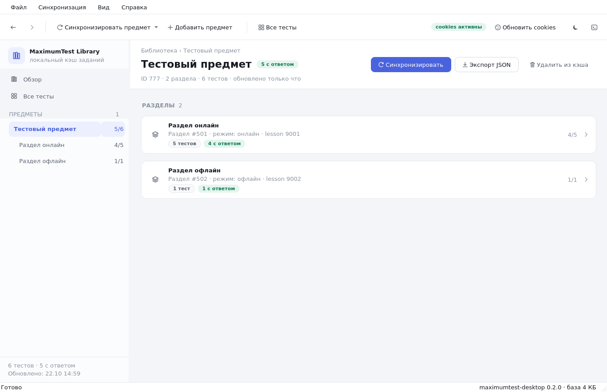

# MaximumTest Library

Десктопный просмотрщик заданий [education.maximumtest.ru](https://education.maximumtest.ru)
с локальным кэшем в SQLite. Работает офлайн, ничего не отправляет на сторонние
серверы и не требует пароля — доступ к заданиям выполняется через cookies вашей
сессии в браузере.


<p align="center">
  
  
  
</p>

## Что умеет

- **Синхронизация** предметов и разделов в локальную базу SQLite (WAL, пакетные
  транзакции), с отменой, повтором и подробным журналом.
- **Дерево предметов** в боковой панели: разделы и счётчики «с ответом / всего».
- **Мгновенный поиск** по всей базе: название, ID, тип, раздел. Поиск
  регистронезависимый для кириллицы.
- **Просмотр задания**: условие с форматированием, все варианты с отмеченными
  правильными, готовый ответ и метаданные (lessonId, время сохранения).
- **Автоответ** для типов `type1`–`type5`. Для `type5` варианты подбираются
  согласованно — без «смешанных» пар.
- **Отправка ответа** с явным подтверждением (опционально — действие изменяет
  результат в личном кабинете).
- **Экспорт** предмета в JSON и просмотр исходного payload любого задания.
- **Светлая и тёмная тема**, автоматически подхватывает системную.
- Горячие клавиши, история навигации, сохранение геометрии окна.

## Установка

Нужен Python 3.11+ и Linux с графической сессией (X11 или Wayland).

```bash
git clone https://github.com/InaymeI/HWlibrary.git
cd HWlibrary
./run.sh
```

`run.sh` создаст `.venv`, установит зависимости и запустит приложение.
Вручную то же самое:

```bash
python -m venv .venv
./.venv/bin/pip install -e .
./.venv/bin/python -m mt
```

## Первый запуск

1. Войдите на **education.maximumtest.ru** в браузере.
2. В приложении нажмите **Cookies сессии** → «Импорт из Firefox» (или
   скопируйте заголовок `Cookie` из DevTools → Network и вставьте в поле).
3. **Добавить предмет** — вставьте ссылку вида
   `https://education.maximumtest.ru/subjects/1234/` или просто `1234`.
4. После синхронизации задания доступны офлайн.

### Где хранятся данные

| Что            | Путь                                                    |
| -------------- | ------------------------------------------------------- |
| База SQLite    | `~/.local/share/maximumtest-desktop/data.sqlite3`       |
| Cookies        | `~/.local/share/maximumtest-desktop/cookies.json` (0600) |
| Настройки      | `~/.config/maximumtest-desktop/`                        |
| Журнал/кэш     | `~/.cache/maximumtest-desktop/`                         |

Каталоги можно переопределить переменными `XDG_DATA_HOME`, `XDG_CONFIG_HOME`,
`XDG_CACHE_HOME` или точечно — `MT_DATA_DIR`, `MT_CONFIG_DIR`, `MT_CACHE_DIR`.

## Быстрые клавиши

| Клавиши    | Действие                          |
| ---------- | --------------------------------- |
| `F5`       | синхронизировать текущий предмет   |
| `Ctrl+R`   | обновить интерфейс из кэша        |
| `Ctrl+N`   | добавить предмет                  |
| `Ctrl+F`   | поиск по всем тестам              |
| `Ctrl+L`   | журнал синхронизации              |
| `Alt+←/→`  | назад / вперёд                    |
| `F1`       | справка                           |
| `Ctrl+Q`   | выход                             |

## Командная строка

```bash
python -m mt --help
python -m mt --theme dark                 # светлая/тёмная/системная тема
python -m mt --db /tmp/test.sqlite3       # отдельная база
python -m mt --sync 1234                  # синхронизировать предмет и выйти
```

`--sync` удобно вызывать по cron: приложение не открывает окно и печатает
прогресс в stdout.

## Разработка

```bash
./.venv/bin/pip install -e ".[dev]"
./.venv/bin/python -m pytest            # 26 тестов, включая фиктивный сервер
./.venv/bin/python -m ruff check mt tests
```

Тесты не ходят в интернет: `tests/fake_server.py` поднимает локальный HTTP-сервер,
повторяющий нужные эндпоинты, и проверяет весь путь «синхронизация → база →
поиск → автоответ → отправка».

### Архитектура

```
mt/
├── __main__.py      точка входа, CLI, Wayland-детект
├── config.py        пути, эндпоинты, константы (без побочных эффектов при импорте)
├── db.py            SQLite-кэш: схема, миграции, запросы, агрегаты
├── api.py           HTTP-клиент: ретраи, таймауты, безопасное хранение cookies
├── models.py        разбор payload'ов API в датаклассы + кэш разбора
├── answers.py       сборка ответа для типов type1–type5
├── sync.py          фоновый поток синхронизации (QThread)
├── theme.py         светлая/тёмная палитры и общий QSS
├── icons.py         иконки, рисуемые QPainter (без внешних ассетов)
├── widgets.py       переиспользуемые элементы интерфейса
└── ui/
    ├── main_window.py  окно, боковая панель, навигация, синхронизация
    ├── pages.py        обзор, предмет, раздел, задание, все тесты
    └── dialogs.py      cookies, JSON, подтверждение отправки, результат, справка
```

Принципы:

- **UI никогда не парсит JSON.** Разбор живёт в `models.py` и кэшируется.
- **Соединение SQLite — на поток.** Запись только из воркера, чтение из UI.
- **Пакетная запись.** Один раздел — одна транзакция; упавшая синхронизация не
  ломает уже сохранённые данные.
- **Никаких внешних ассетов.** Иконки рисуются кодом, тема — один QSS-шаблон.

## Статус проекта

Приложение неофициальное. Эндпоинты могут измениться на стороне сервиса;
в этом случае синхронизация сообщит об ошибке, но кэш останется нетронутым.
Отправка ответов — на ваш риск.

## Лицензия

MIT
