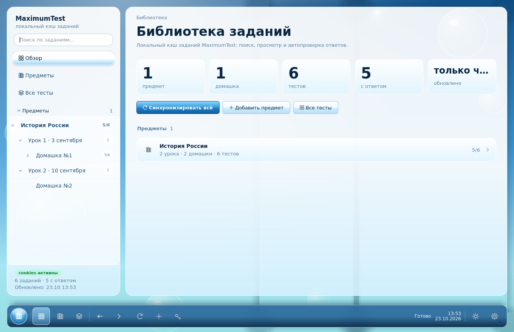
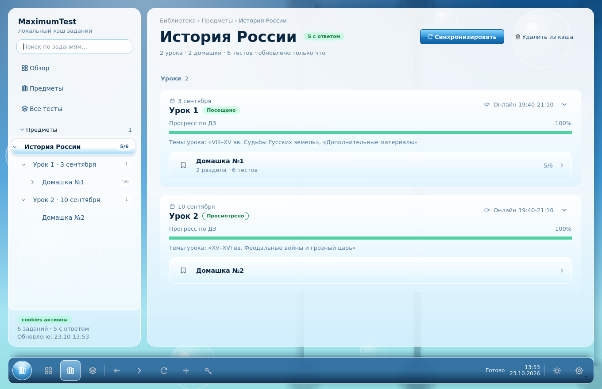
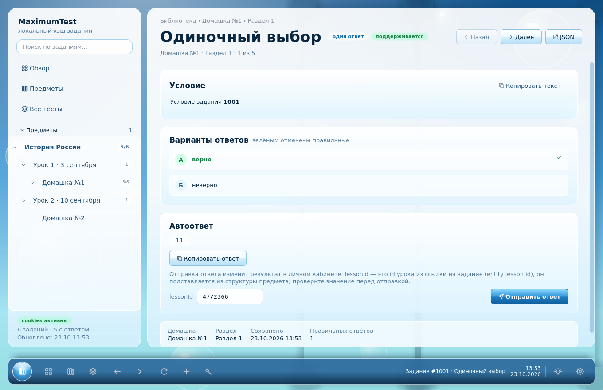

# Frutiger Aero — экспериментальная тема

Изолированная работа в ветке `arena/200e0d0b-hwlibrary`. Не слита в `main`.

Включение: **Настройки / Пуск → Вид → Тема → Frutiger Aero (Windows 7)**.
Кнопка темы перебирает светлую, тёмную и Aero. Выбор сохраняется между запусками.
Прежние темы остаются доступными; данные SQLite и синхронизация не изменены.

- Небесный градиент, солнечная дымка, прозрачные пузыри.
- Светлые стеклянные панели и глянцевые голубые кнопки.
- Нижняя панель задач вместо вертикальной навигации.
- Круглая кнопка «Пуск», меню приложения, статус синхронизации и часы.
- При смене темы расположение панели и строки состояния восстанавливается.

Это стилизация, а не системный Windows Aero: размытия содержимого за окном нет.
Рисование выполняется средствами Qt без внешних библиотек или сетевых ресурсов.

## Скриншоты

## Проверка

`ruff check mt tests` — чисто. `pytest tests -q` — 90 passed.
Добавлены проверки повторного переключения темы, расположения панели задач,
часов, передачи статуса, навигации и рендеринга страниц.
